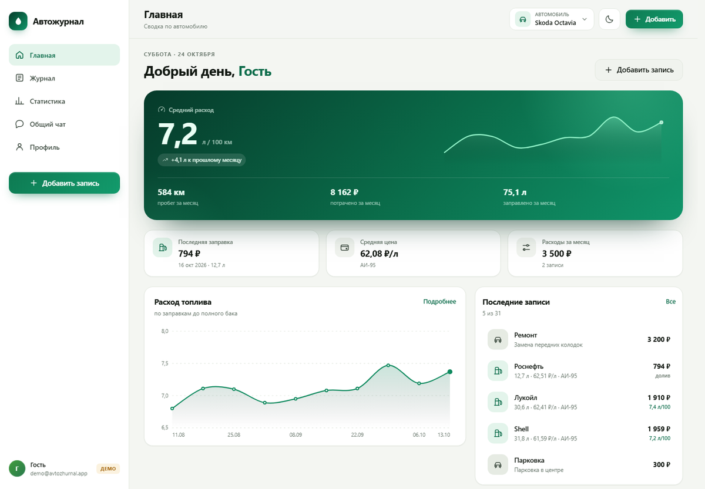
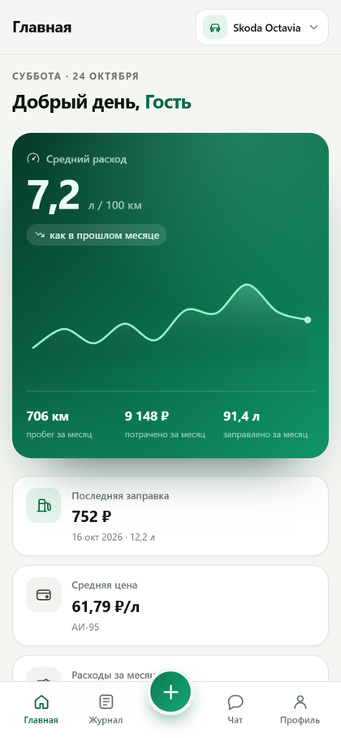
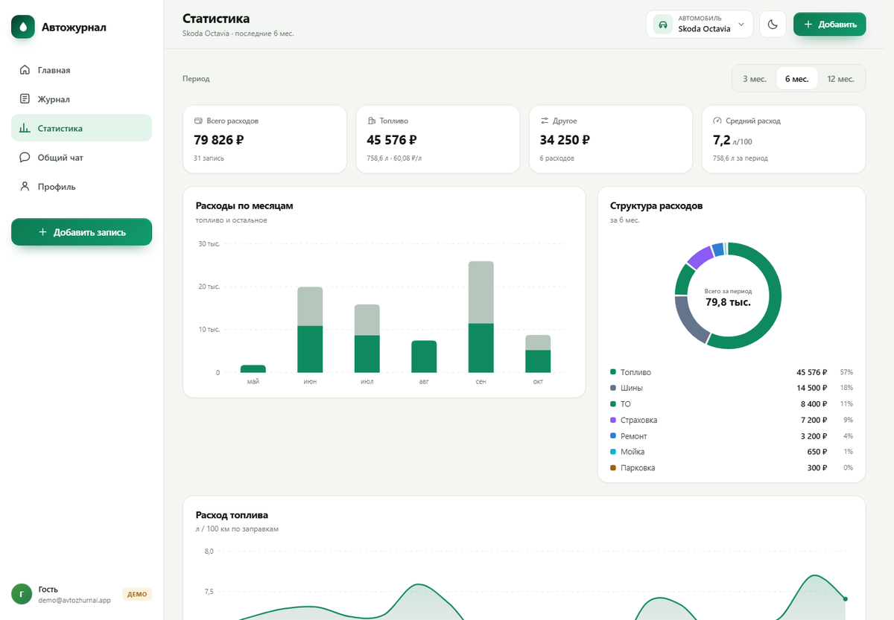
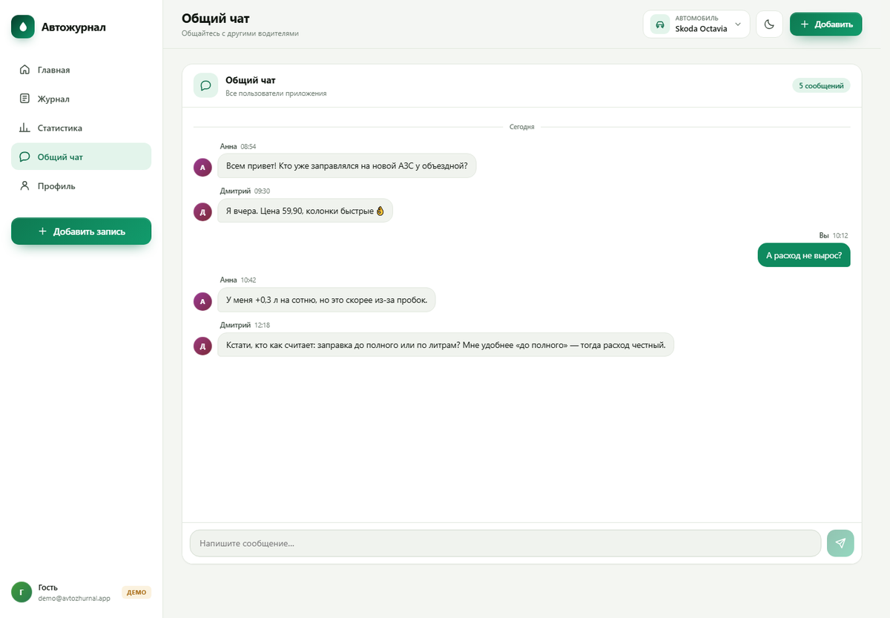

# ⛽ Автожурнал — PWA для учёта топлива и расходов

Готовое веб-приложение для учёта заправок, расхода топлива и любых трат на автомобиль.
Красивый русский интерфейс, регистрация и вход по email, личный кабинет у каждого пользователя
и общий чат для всех. Ставится как приложение на телефон и компьютер.



| Мобильная версия | Статистика | Чат |
| --- | --- | --- |
|  |  |  |

---

## Что умеет

- **Аккаунты.** Регистрация и вход по email и паролю, сброс пароля письмом. У каждого пользователя — свои данные.
- **Несколько автомобилей.** Переключение в шапке, отдельная статистика по каждому.
- **Заправки.** Дата, одометр, литры, цена за литр, сумма, АЗС, тип топлива, «полный бак», заметка.
- **Расходы.** ТО, ремонт, страховка, налог, штраф, мойка, шины, парковка, прочее.
- **Автоматические расчёты.** Расход л/100 км, средняя цена литра, пробег и траты за месяц, динамика к прошлому месяцу.
- **Статистика.** KPI за 3/6/12 месяцев, столбчатый график расходов, кольцевая структура трат, график расхода, таблица по месяцам.
- **Общий чат.** Простой чат в реальном времени: все авторизованные пользователи видят сообщения друг друга.
- **Экспорт.** Все данные выгружаются в JSON одним нажатием.
- **PWA.** Устанавливается на Android, iPhone и десктоп, оболочка кэшируется для офлайна, тёмная тема.
- **Демо-режим.** Можно посмотреть интерфейс с тестовыми данными вообще без настройки сервера.

> Важно: GitHub Pages — это только статика. Регистрация, пароли и общий чат требуют бэкенда,
> поэтому приложение использует **Firebase** (бесплатный тариф Spark). Настройка занимает ~15 минут.

---

## Быстрый старт за 2 минуты (демо)

1. Скачайте папку проекта `avtozhurnal` (или клонируйте репозиторий).
2. Запустите локальный сервер из папки проекта — **не открывайте `index.html` двойным кликом**:
   ES-модули не работают по протоколу `file://`.

   ```bash
   npx serve . -l 8080
   # или
   python -m http.server 8080
   ```

3. Откройте `http://localhost:8080` и нажмите **«Посмотреть демо»**.
4. Демо-данные хранятся только в `localStorage` вашего браузера. Чтобы сбросить — очистите данные сайта.

Когда захотите настоящие аккаунты и общий чат между устройствами — переходите к Firebase.

---

## Шаг 1. Подключение Firebase (~15 минут)

Понадобится аккаунт Google. Все действия — в [консоли Firebase](https://console.firebase.google.com).

### 1.1. Создайте проект

1. Нажмите **«Создать проект»** (Create project).
2. Название, например `avtozhurnal`. Продолжить.
3. Google Analytics можно отключить — приложению она не нужна.
4. Дождитесь создания и нажмите **«Продолжить»**.

### 1.2. Добавьте веб-приложение и получите конфигурацию

1. На главной странице проекта нажмите значок **`</>`** (Web).
2. Придумайте nickname, например `avtozhurnal-web`. Регистрация приложения.
3. Откроется шаг **Add Firebase SDK** с вкладками **npm** и **`<script>`**. Выберите любую — объект
   `firebaseConfig` в них одинаковый. В проект **ничего** из этих инструкций добавлять не нужно:
   Firebase SDK уже лежит в папке `vendor/`, а импорты в `js/api-firebase.js` настроены.
   Не выполняйте `npm install firebase` и не вставляйте CDN-теги `<script src="...firebase...">` —
   иначе приложение попытается загрузить вторую копию SDK.
4. Скопируйте **только** объект `firebaseConfig` — от `{` до `}`. Не копируйте
   `npm install`, `import { initializeApp } ...` и теги `<script>`.
5. Откройте файл **`js/firebase-config.js`** и замените значения:

   ```js
   export const firebaseConfig = {
     apiKey: "AIzaSy...",
     authDomain: "avtozhurnal-12345.firebaseapp.com",
     projectId: "avtozhurnal-12345",
     storageBucket: "avtozhurnal-12345.firebasestorage.app",
     messagingSenderId: "123456789012",
     appId: "1:123456789012:web:abcdef123456"
   };
   ```

   Скопируйте значения **точно как в консоли**: у старых проектов `storageBucket` бывает
   вида `project-id.appspot.com`, у новых — `project-id.firebasestorage.app`.
   Если включали Analytics, в объекте будет ещё `measurementId` — его можно оставить,
   приложению он не мешает. Строку `export const isFirebaseConfigured = ...` ниже не удаляйте:
   по ней приложение понимает, что конфигурация заполнена.
6. Сохраните файл. Ключи Firebase **не являются секретными** — они публичны по задумке.
   Доступ к данным защищают правила Firestore, а не секретность конфигурации.

### 1.3. Включите вход по email и паролю

1. В левом меню: **Authentication** → **Get started**.
2. Вкладка **Sign-in method** → **Email/Password** → включите **Enable** → **Save**.
3. Дополнительно (по желанию): **Authentication → Templates** — переведите письма сброса пароля на русский.

### 1.4. Создайте Firestore

1. В левом меню: **Firestore Database** → **Create database**.
2. Выберите **Production mode** (не test mode — правила добавим вручную).
3. Регион: ближайший к вам, например `europe-west3` (Франкфурт). **Регион нельзя изменить позже.**
4. Нажмите **Create** и дождитесь окончания.

### 1.5. Опубликуйте правила безопасности

1. В Firestore откройте вкладку **Rules**.
2. Полностью замените содержимое на текст из файла **`firestore.rules`** в проекте.
3. Нажмите **Publish**.

Правила разрешают пользователю читать и писать только свои документы, а чат — читать всем
авторизованным и создавать сообщения только от своего имени.

### 1.6. Добавьте домен сайта в разрешённые

1. **Authentication** → вкладка **Settings** → **Authorized domains**.
2. `localhost` уже есть — он нужен для локальной проверки.
3. Нажмите **Add domain** и добавьте домен GitHub Pages **без пути**:
   `ваш-логин.github.io`.
4. Если будете подключать свой домен — добавьте и его (`example.ru`).

Без этого шага приложение покажет ошибку `auth/unauthorized-domain`.

### 1.7. Проверьте локально

1. Запустите сервер (`npx serve . -l 8080`).
2. Откройте сайт — вместо экрана настройки появится форма входа.
3. Зарегистрируйтесь, добавьте две заправки «до полного бака» и убедитесь, что расход посчитался.
4. Проверьте чат: откройте сайт в другом браузере или приватном окне, создайте второй аккаунт,
   отправьте сообщение — оно должно появиться у обоих.

**Необязательно, но полезно:**

- **App Check** (Firebase → App Check) — защита от сторонних запросов к вашему проекту.
- **Budget alerts** в Google Cloud — уведомление, если расходы превысят бесплатные лимиты.
- **Email verification** — можно включить в Authentication → Templates, но приложение не требует подтверждения почты.

---

## Шаг 2. Публикация на GitHub Pages (~5 минут)

### Вариант А. Через сайт GitHub (проще, без git)

1. Войдите на GitHub и создайте репозиторий: **New repository**.
2. Имя, например `avtozhurnal`. Тип — **Public** (на бесплатном тарифе GitHub Pages работает только в публичных репозиториях).
3. **Create repository**.
4. Нажмите **Add file → Upload files** и перетащите **содержимое** папки `avtozhurnal` так, чтобы
   в корне репозитория оказались `index.html`, `js/`, `css/`, `vendor/`, `icons/`, `sw.js` и остальные файлы.
   Папки `js`, `css`, `vendor`, `icons` должны сохраниться.
5. Нажмите **Commit changes**.
6. Откройте **Settings → Pages**.
7. В блоке **Build and deployment**:
   - **Source**: `Deploy from a branch`;
   - **Branch**: `main`, папка `/ (root)`;
   - **Save**.
8. Через 1–2 минуты сайт будет доступен по адресу:
   `https://ваш-логин.github.io/avtozhurnal/`
9. Вернитесь в Firebase → **Authentication → Settings → Authorized domains** и добавьте
   `ваш-логин.github.io`, если ещё не добавили.

### Вариант Б. Через git

```bash
cd avtozhurnal
git init
git add .
git commit -m "Автожурнал: PWA учёта топлива и расходов"
git branch -M main
git remote add origin https://github.com/ВАШ-ЛОГИН/avtozhurnal.git
git push -u origin main
```

Затем включите Pages: **Settings → Pages → Deploy from a branch → main / (root) → Save**.

### Где взять домен и что писать в Firebase

В проекте встречаются три разных адреса — и ни один из них не нужно покупать для базовой версии.

| Адрес | Откуда берётся | Покупать? |
| --- | --- | --- |
| `demo@avtozhurnal.app` | вымышленный email демо-пользователя | Нет, это только демонстрация |
| `ваш-логин.github.io` | бесплатный домен GitHub Pages | Нет, выдаётся автоматически |
| `project-id.firebaseapp.com` | `authDomain` из конфигурации Firebase | Нет, выдаётся Firebase при создании проекта |

**Домен сайта на GitHub Pages.** После включения Pages GitHub выдаёт адрес вида:

```
https://ваш-логин.github.io/имя-репозитория/
```

Домен здесь — только `ваш-логин.github.io`. Часть `/имя-репозитория/` — это путь, а не домен.
В Firebase → Authentication → Settings → Authorized domains добавляется именно
`ваш-логин.github.io` — без `https://`, без пути и без слэша на конце.

Пример: логин `ivan`, репозиторий `avtozhurnal` → сайт `https://ivan.github.io/avtozhurnal/`,
в Firebase добавляем `ivan.github.io`.

Если назвать репозиторий `ivan.github.io`, сайт откроется по корню `https://ivan.github.io/`,
но домен для Firebase останется тем же — `ivan.github.io`.

**Свой домен (необязательно).** Если нужен адрес вида `avtozhurnal.ru`:

1. Купите домен у регистратора. В России: `reg.ru`, `timeweb.com`, `beget.com`, `nic.ru`.
   Международные: `Namecheap`, `Porkbun`, `Cloudflare Registrar`. Смотрите цену продления,
   а не только первого года: `.ru` обычно от нескольких сотен рублей в год, `.com` — от ~$10–15.
2. В GitHub: **Settings → Pages → Custom domain** → введите `example.ru` → **Save**.
   GitHub сам создаст файл `CNAME` в репозитории. Если деплой идёт через GitHub Actions,
   добавьте `CNAME` с доменом вручную, иначе он может не попасть в сборку.
   GitHub может также попросить подтвердить владение доменом через TXT-запись — следуйте подсказке.
3. В панели регистратора настройте DNS:

   | Тип | Имя | Значение |
   | --- | --- | --- |
   | `A` | `@` | `185.199.108.153` |
   | `A` | `@` | `185.199.109.153` |
   | `A` | `@` | `185.199.110.153` |
   | `A` | `@` | `185.199.111.153` |
   | `CNAME` | `www` | `ваш-логин.github.io` |

   Если домен обслуживается через Cloudflare, для записей GitHub включите **DNS only**
   (серое облако), иначе возможны ошибки HTTPS.
4. Подождите от 15 минут до 24 часов. Проверьте: `nslookup example.ru` или `dig example.ru`.
   Когда DNS заработает, в GitHub Pages включите **Enforce HTTPS**.
5. Вернитесь в Firebase → **Authentication → Settings → Authorized domains** и добавьте
   оба варианта: `example.ru` и `www.example.ru`.
6. Проверьте `https://example.ru` и `https://www.example.ru`.

**Где посмотреть текущий адрес сайта:** репозиторий → **Settings → Pages** — там будет строка
«Your site is live at …». Это и есть ваш домен.

**Бесплатные альтернативы GitHub Pages:** Netlify (`*.netlify.app`), Vercel (`*.vercel.app`),
Cloudflare Pages (`*.pages.dev`). Домен выдаётся автоматически, его нужно добавить в Firebase
Authorized domains так же, как `ваш-логин.github.io`.

**Для локальной проверки домен не нужен:** `http://localhost:8080` — это ваш компьютер,
`localhost` уже разрешён в Firebase по умолчанию.

### Если что-то не открылось

- Убедитесь, что в корне репозитория лежит `index.html`, а не папка `avtozhurnal/`.
- В репозитории должен быть файл **`.nojekyll`** (он уже есть в проекте) — иначе GitHub может
  проигнорировать часть файлов.
- Откройте сайт в режиме инкогнито или обновите страницу с `Ctrl+F5`.
- Проверьте вкладку **Actions** / **Pages** в настройках репозитория: там виден статус деплоя.

---

## Шаг 3. Установка как приложение (PWA)

Сайт уже содержит манифест, иконки и service worker. Устанавливается так:

- **Android (Chrome):** меню ⋮ → **«Установить приложение»** или **«Добавить на главный экран»**.
- **iPhone / iPad (Safari):** кнопка «Поделиться» → **«На экран „Домой“»**.
  (В Chrome на iOS установка PWA недоступна — используйте Safari.)
- **Компьютер (Chrome / Edge):** значок установки в адресной строке → **«Установить»**.

Требования: сайт открыт по **HTTPS** (GitHub Pages это даёт) и хотя бы раз загружен.
Оболочка приложения кэшируется и открывается без сети; данные Firebase читаются из офлайн-кэша,
а новые записи ставятся в очередь и отправляются при появлении интернета.

---

## Как пользоваться

### Заправки и расчёт расхода

1. Нажмите **«Добавить»** (или «+» в мобильном меню).
2. Выберите **«Заправка»**, заполните дату, одометр, литры и цену.
   Сумма посчитается сама; её можно поправить вручную — тогда пересчитается цена за литр.
3. Оставьте включённым **«Заправка до полного бака»** — это важно для честного расхода.
   Если долили 10–15 литров в дороге, переключатель лучше выключить.
4. Сохраните. После **второй** заправки до полного бака появится расход л/100 км,
   а на главной — график.

Формула: `расход = литры между полными баками / пробег × 100`.
Промежуточные (неполные) заправки учитываются в литрах, но не начинают новый отрезок расчёта.

Пример: полный бак на 50 000 км, следующая полная заправка 40 л на 50 550 км →
`40 / 550 × 100 = 7,27 л/100 км`.

### Расходы

Вкладка **«Расход»** в форме: дата, категория, сумма, комментарий. Категории: ТО, ремонт,
страховка, налог, штраф, мойка, шины, парковка, прочее.

### Журнал

- Переключатель **Заправки / Расходы / Всё**.
- Стрелки `‹ ›` листают месяцы.
- Сводка сверху: количество записей, топливо, прочее, пробег.
- Нажмите на запись, чтобы изменить или удалить её.

### Статистика

Период 3 / 6 / 12 месяцев. Показывает общие траты, топливо, прочие расходы, средний расход,
график по месяцам, структуру трат и таблицу.

### Автомобили

**Профиль → Автомобили**. Можно добавить несколько машин, переключаться в шапке,
редактировать название, марку и номер. При удалении машины удаляются и её записи.

### Чат

**Общий чат** — одно общее пространство для всех пользователей приложения.
Сообщения отправляются по Enter (Shift+Enter — перенос строки), максимум 500 символов.
Сообщения нельзя редактировать или удалять из интерфейса — это сделано намеренно, чтобы чат оставался простым.

### Экспорт

**Профиль → Данные → Скачать** — JSON со всеми автомобилями, заправками и расходами.

---

## Структура проекта

```
avtozhurnal/
├── index.html              # разметка: экран входа, настройки, приложение, иконки
├── manifest.webmanifest    # PWA-манифест (имя, иконки, цвета)
├── sw.js                   # service worker: офлайн-кэш оболочки
├── firestore.rules         # правила безопасности Firestore
├── .nojekyll               # отключает Jekyll на GitHub Pages
├── css/
│   └── app.css             # дизайн-система, светлая и тёмная темы, адаптив
├── js/
│   ├── app.js              # вся логика интерфейса, экраны, формы, модальные окна
│   ├── api.js              # выбор бэкенда: Firebase или демо
│   ├── api-firebase.js     # Auth + Firestore
│   ├── api-demo.js         # локальное демо на localStorage
│   ├── firebase-config.js  # ← сюда вставляется конфигурация Firebase
│   ├── utils.js            # форматирование дат, чисел, денег
│   ├── stats.js            # расчёт расхода и месячных итогов
│   └── charts.js           # SVG-графики без внешних библиотек
├── vendor/                 # Firebase JS SDK 10.14.1 (локально, для офлайна)
├── icons/                  # иконки 192/512, maskable, apple-touch
└── docs/                   # скриншоты для README
```

Сборка не нужна: это статический сайт на ES-модулях. Все зависимости лежат в `vendor/`,
поэтому приложение не зависит от CDN.

---

## Данные и безопасность

### Модель данных

| Коллекция | Поля |
| --- | --- |
| `users/{uid}` | `name`, `email`, `createdAt` |
| `users/{uid}/cars/{carId}` | `name`, `make`, `plate`, `createdAt` |
| `users/{uid}/refuels/{id}` | `carId`, `date`, `odometer`, `liters`, `pricePerLiter`, `total`, `station`, `fuelType`, `fullTank`, `note`, `createdAt` |
| `users/{uid}/expenses/{id}` | `carId`, `date`, `category`, `amount`, `note`, `createdAt` |
| `chat/{messageId}` | `uid`, `name`, `text`, `createdAt` |

Даты хранятся строками `YYYY-MM-DD`, время создания — Firestore Timestamp.

### Правила

- Пользователь читает и пишет **только** свои `users/{uid}/…`.
- Чат читают все авторизованные; создать сообщение можно только с `uid` текущего пользователя.
- Редактирование и удаление сообщений чата запрещены правилами.
- Всё остальное закрыто.

### Что важно понимать

- `firebaseConfig` в коде — публичные идентификаторы, их можно коммитить.
- **Никогда** не кладите в репозиторий service account JSON, приватные ключи и пароли.
- Кто угодно может зарегистрироваться в вашем приложении и писать в общий чат —
  это открытый сервис. Для приватного использования ограничьте регистрацию (например,
  отключите публичную регистрацию и создавайте пользователей вручную в консоли Firebase).
- Модерировать чат можно в **Firestore → chat**: удалить сообщение или добавить поле `hidden`
  и фильтровать его в коде (потребуется доработка).
- Бесплатный тариф Spark: примерно 50 000 чтений и 20 000 записей в день, 1 ГиБ хранилища.
  Для семьи и друзей этого более чем достаточно.

---

## Обновление сайта

1. Измените файлы и закоммитьте:
   ```bash
   git add .
   git commit -m "Обновление"
   git push
   ```
2. В файле `sw.js` увеличьте версию кэша:
   ```js
   const CACHE_VERSION = "avtozhurnal-v2";
   ```
   Иначе service worker продолжит отдавать старую оболочку.
3. GitHub Pages обновится за 1–2 минуты (иногда до 10 из-за кэша CDN).
4. Пользователям может понадобиться закрыть и открыть приложение дважды:
   первый запуск скачивает новый service worker, второй — использует его.

---

## Локальный запуск и правки

```bash
# из папки проекта
npx serve . -l 8080          # Node.js
python -m http.server 8080   # Python
```

Откройте `http://localhost:8080`.

- Для проверки демо добавьте `?demo=1`.
- Для работы с Firebase заполните `js/firebase-config.js` и добавьте `localhost` в Authorized domains
  (он там уже есть по умолчанию).
- Файлы правятся как обычный HTML/CSS/JS, пересборка не требуется.
- После правок CSS/JS обновите страницу с `Ctrl+F5` или временно отключите service worker
  в DevTools → Application → Service Workers.

---

## Другие платформы

Приложение — статический сайт, поэтому подойдёт любой бесплатный хостинг со HTTPS.
Везде нужно добавить домен в Firebase Authorized domains.

| Платформа | Как опубликовать |
| --- | --- |
| **Netlify** | [app.netlify.com/drop](https://app.netlify.com/drop) — перетащите папку проекта. |
| **Vercel** | Импорт репозитория → Framework: Other → Output directory: `.` → Deploy. |
| **Cloudflare Pages** | Подключите репозиторий, Build command пустой, Output directory `/`. |
| **Firebase Hosting** | `npm i -g firebase-tools` → `firebase login` → `firebase init hosting` (public: `.`) → `firebase deploy`. |
| **Свой сервер** | Любой nginx/Apache, HTTPS обязателен для PWA. |

### А если нужен другой бэкенд?

Архитектура разделена: `js/api.js` выбирает реализацию, а `app.js` работает с единым интерфейсом
(`signIn`, `subscribeRefuels`, `addRefuel`, `sendMessage` и т.д.). Чтобы перейти на **Supabase**,
**PocketBase** или собственный API, достаточно написать свой `api-*.js` с теми же методами.
База данных и чат тогда будут вне Firebase, а GitHub Pages останется хостингом.

---

## Частые проблемы

| Симптом | Причина | Решение |
| --- | --- | --- |
| Белый экран, в консоли `Failed to load module` | Сайт открыт как `file://` или неверные пути | Запустите локальный сервер; проверьте, что файлы лежат в корне репозитория |
| 404 на GitHub Pages | Pages не включён, не та ветка или файлы в подпапке | Settings → Pages → main / (root); `index.html` должен быть в корне |
| `auth/unauthorized-domain` | Домен не добавлен в Firebase | Authentication → Settings → Authorized domains → добавьте `логин.github.io` |
| `Missing or insufficient permissions` | Правила не опубликованы или чужой проект | Опубликуйте `firestore.rules`; проверьте `projectId` в конфиге |
| `auth/operation-not-allowed` | Не включён вход Email/Password | Authentication → Sign-in method → Email/Password → Enable |
| Письмо сброса пароля не приходит | Спам, шаблон, лимиты | Проверьте «Спам», шаблоны Authentication → Templates; попробуйте другой email |
| Чат пустой / не отправляется | Не выполнен вход или правила чата не опубликованы | Войдите; опубликуйте правила; проверьте консоль браузера |
| Изменения не видны | Кэш service worker / CDN GitHub | Увеличьте `CACHE_VERSION`, обновите дважды, `Ctrl+F5` |
| PWA не устанавливается | Нет HTTPS, не тот браузер | HTTPS; Android — Chrome, iPhone — Safari |
| Демо-данные пропали | Очищены данные сайта / другой браузер | Демо хранится в `localStorage`; это нормально |
| «Не удалось включить офлайн-кэш» | Приватный режим браузера | Приложение продолжит работать без офлайн-кэша |
| Превышена квота Firebase | Лимиты Spark | Подождите сутки или подключите тариф Blaze с бюджетным лимитом |

---

## Ограничения и идеи развития

- Чат общий и без модерации; загружаются последние 80 сообщений, пагинации нет.
- Нет подтверждения email и капчи при регистрации.
- Нет загрузки фото чеков (потребуется Firebase Storage).
- Нет импорта из файла — только экспорт.
- При одновременном редактировании с двух устройств побеждает последняя запись (last write wins).
- Нет напоминаний о ТО и учёта показаний спидометра вне заправок.

Что можно добавить позже: несколько чатов/личные сообщения, реакции, фото чеков, импорт CSV,
напоминания о ТО, график цены на топливо по АЗС, PWA-виджеты, административную панель.

---

## Лицензия

MIT — используйте, меняйте и публикуйте свободно. См. [LICENSE](LICENSE).
